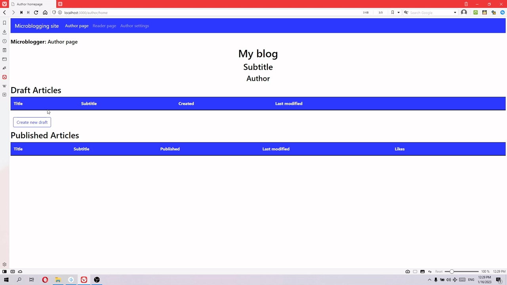
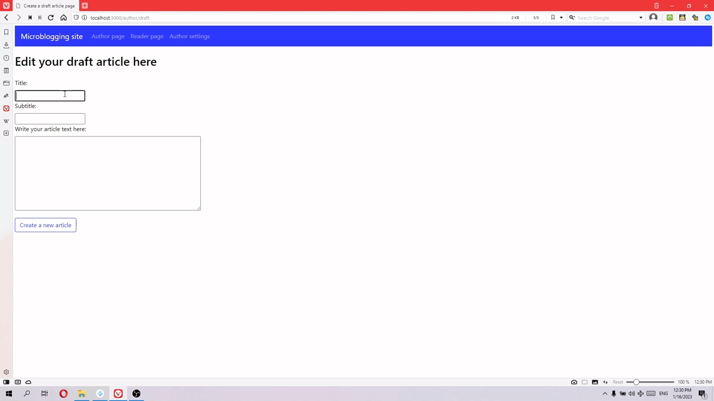
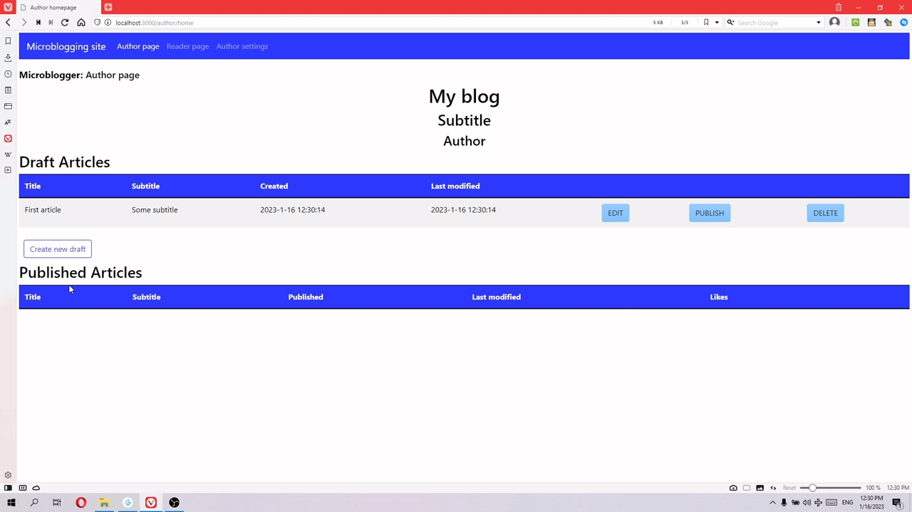
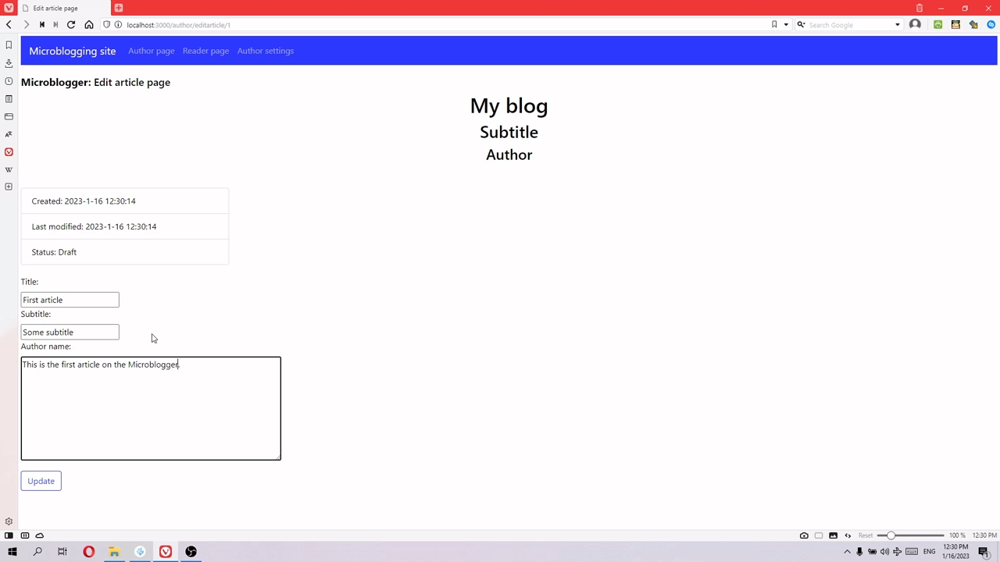
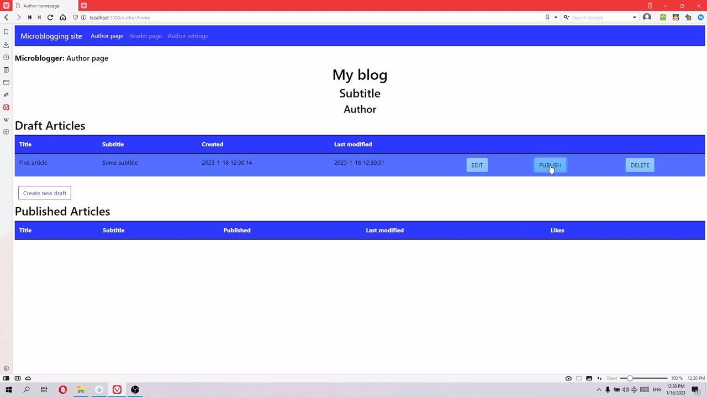
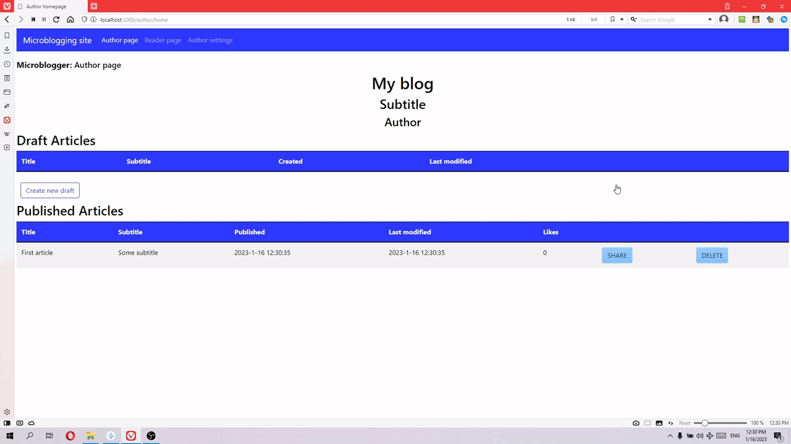
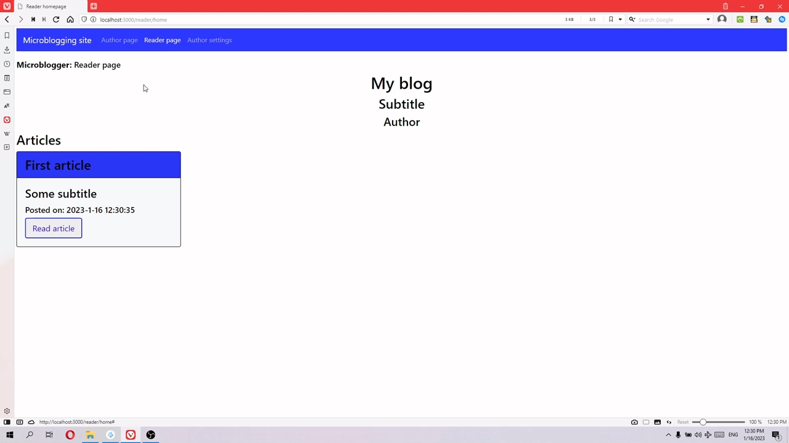
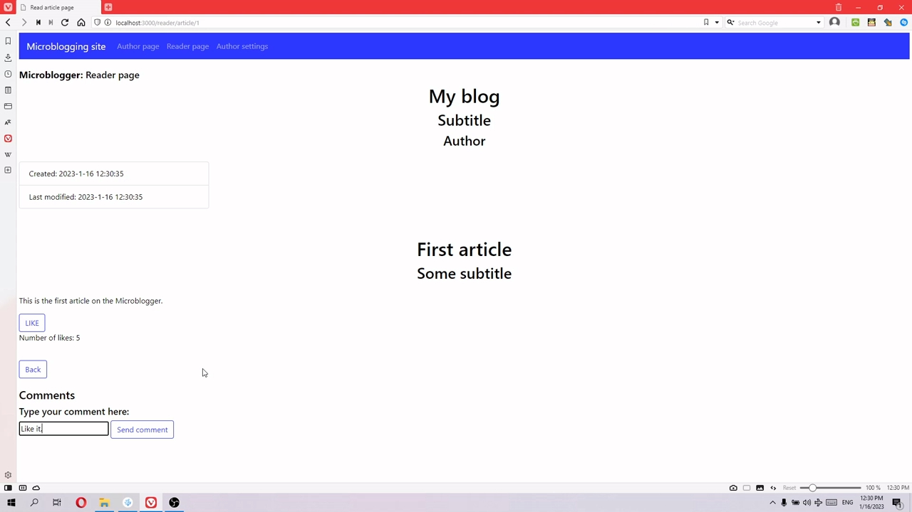
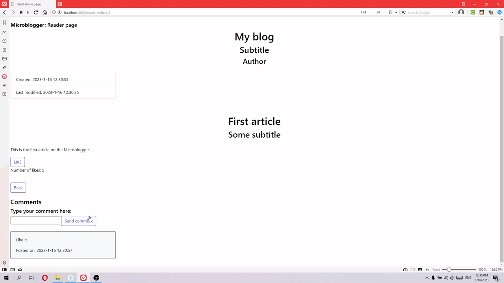

# BasicMicrobloggingSite
Originally written as a midterm project for CM2040 Database Networks and the Web mmodule of the University of London Bachelor of Science Computer Science program by László Stefán.

## Requirements

Node.js needs to be installed for the program to run. 

Original commands in the template provided by the university follow. 

To install all the node packages run ```npm install``` from the project directory

Run ```npm run build-db``` to create the database (database.db)
Run ```npm run start``` to start serving the web app (Access via http://localhost:3000)

You can also run: 
```npm run clean-db``` to delete the database before rebuilding it for a fresh start

## Function

With this application, the user is able to write text articles, save them as a draft and publish them. Comments can be added to each of the articles. 

## Accessing the author and the reader pages ###

The author page is available under localhost:3000/author/home, and the reader page is on localhost:3000/reader/home, the draft page under localhost:3000/author/draft, and the settings page under localhost:3000/author/settings.


## Note on operating systems

If the user is on Linux or Mac, the package.json file should be changed from: 

"scripts": {
    "test": "echo \"Error: no test specified\" && exit 1",
    "build-db": "type db_schema.sql | sqlite3 database.db ",
    "clean-db": "del /f database.db",
    "start": "node index.js"
  },

to:

"scripts": {
    "test": "echo \"Error: no test specified\" && exit 1",
    "build-db": "cat db_schema.sql | sqlite3 database.db ",
    "clean-db": "rm database.db",
    "start": "node index.js"
  },

## Screenshots

There is a demo video in the screenshots folder.

















